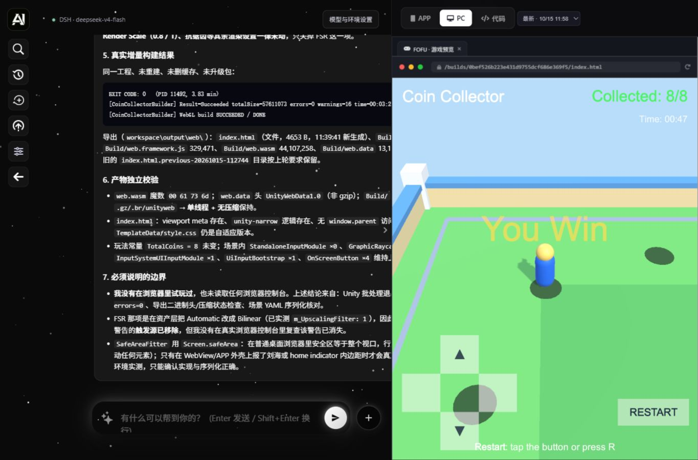

# AIWEB

在现有网页里描述需求，由 **DeepSeek Harness（DSH）+ DeepSeek 官方 API + Unity Skills** 制作游戏，再把真实 Unity Web 构建显示回网页。

Python 后台负责接口、任务排队、SQLite 记录和作品文件；智能体的模型调用、工具调用和执行流程使用官方 DSH SDK，没有另写智能体框架。**Python 和 DSH 依赖统一由 uv 管理，不需要 npm 或 npx。**



## 准备环境

目前完整流程在 **Windows x64** 上验证。其他系统和架构尚未完成整体验证。

| 需要准备 | 用途 |
| --- | --- |
| [Git](https://git-scm.com/downloads) | 拉取项目 |
| [uv](https://docs.astral.sh/uv/getting-started/installation/) | 安装 Python、项目依赖和 DSH |
| [PowerShell 7](https://learn.microsoft.com/powershell/scripting/install/installing-powershell-on-windows) | DSH 在 Windows 上执行命令，需要 `pwsh`；系统自带的 Windows PowerShell 5.1 不能代替 |
| [Unity Hub / Editor](https://unity.com/download) | 安装 Unity Editor 6.x 和对应的 Web Build Support 模块，并使用自己的 Unity 账号激活有效许可证 |
| [Unity CLI](https://github.com/Unity-Technologies/skills/blob/main/skills/unity-cli/SKILL.md) | 供智能体操作 Unity，按官方安装说明配置 |
| DeepSeek 官方 API Key | 在网页中填写自己的密钥，并确认账户可用 |

本机验证版本为 Unity Editor `6000.5.6f1`、Unity CLI `1.0.0-beta.6`、DSH SDK `0.1.5rc1`。Python 版本要求 `3.11+`，uv 可在需要时下载 Python。Unity 和 PowerShell 是系统工具，不会被 `uv sync` 一起安装。

安装后新开一个终端，确认下面的命令可用：

```powershell
git --version
uv --version
pwsh --version
unity --version
```

## 拉取并启动

```powershell
git clone https://github.com/chenggong0306/AIWEB.git
cd AIWEB
uv sync --locked --no-dev --project backend
uv run --locked --no-dev --project backend python backend/run.py
```

打开 **<http://127.0.0.1:8000/>**。不要双击 `ai.html`，也不用单独启动 `dsh web`。

1. 点击网页的「模型与环境设置」，填写自己的 DeepSeek 官方 API Key，并选择账户实际支持的模型名。
2. 查看 DSH、Unity、许可证、Web 模块和 Skills 的检测结果。SDK 可以启动，不代表 Unity 已经配齐。
3. 新建对话，描述要制作的游戏。需要实时操作 Editor 时，智能体会按 Unity Skill 配置当前工程的 Pipeline 包。
4. 完成真实 Unity Web 构建后，右侧会加载游戏；对话结束不代表构建一定成功。

首次启动会自动创建 `backend/.dsh`、安装仓库附带的 8 套 Unity Skills，并创建 `backend/data` 和 SQLite。新拉取者的作品列表是空的，需要自己生成游戏。

端口占用时可用：

```powershell
uv run --locked --no-dev --project backend python backend/run.py --port 8001
```

此时打开 <http://127.0.0.1:8001/>。停止后台按 `Ctrl+C`。同一个数据目录不能同时运行两个后台。

## 配置和本机数据

推荐直接在网页填写密钥。也可以在**启动后台的同一个 PowerShell 终端**设置：

```powershell
$env:DEEPSEEK_API_KEY = '替换成自己的密钥'
uv run --locked --no-dev --project backend python backend/run.py
```

项目没有自动加载 `.env`。当前只连接 DeepSeek 官方 API；接自建模型服务需要后续适配。

| 目录 / 文件 | 内容 | 是否入库 |
| --- | --- | --- |
| `ai.html`、`ai.css`、`ai.js`、`client-api.js`、`image/` | 原有界面、连接逻辑和图片 | 是 |
| `backend/app/` | Python API 和 DSH 适配 | 是 |
| `backend/pyproject.toml`、`backend/uv.lock` | 依赖声明和固定版本 | 是 |
| `backend/resources/skills/` | Unity Skills 快照、引用和第三方许可 | 是 |
| `backend/.venv/` | uv 安装的依赖，包括 DSH runtime | 否，每台电脑自己安装 |
| `backend/.dsh/` | 本机 DSH 配置、技能副本和会话状态 | 否，首次启动创建 |
| `backend/data/` | 密钥配置、SQLite、聊天、上传素材、Unity 工程和构建 | 否，每台电脑独立保存 |

Windows 下，网页保存的密钥使用当前 Windows 账户加密，不能把别人的 `settings.json` 复制过来代用。若 Unity CLI 没在 PATH，可在启动前设置 `$env:UNITY_CLI_PATH = '你的 unity.exe 完整路径'`。

更新代码使用 `git pull`，然后重新执行上面的 `uv sync --locked --no-dev --project backend` 并重启。不要把本机 `.venv`、`.dsh` 或 `data` 提交到仓库。

## 当前范围

- 已验证：网页发需求、DSH 调用官方模型和 Skills、生成 Unity 工程、真实 Web 构建、原网页 APP / PC 预览、金币游戏通关与重开。
- 「APP」是手机尺寸的网页预览，尚未打包 Android / iOS 安装包。「发布」生成本机服务链接，尚未部署公网。
- 当前只监听 `127.0.0.1`，供本机可信用户使用。智能体执行工具具有启动后台的 Windows 用户权限，不是系统级隔离环境。
- 模型和依赖安装需要网络；部分界面图标从 cdnjs 加载。真实手机、跨浏览器性能和长期稳定性尚未完整验证。

## 开发与验证

```powershell
uv sync --locked --project backend
uv run --locked --project backend pytest backend/tests -q
```

服务成功启动一次后，还可从 `backend` 目录运行本地 SDK 集成检查：

```powershell
cd backend
uv run --locked python tests/runtime_probe.py --patch .dsh/aiweb.patch.yml --patch .dsh/unity-skills.patch.yml --expect-skill unity-cli
```

该检查使用本地模拟 API，实际启动 DSH 并执行无害的 shell 命令，不调用付费模型。详细结构见 [后台说明](backend/README.md)，历史实测见 [验证记录](backend/VALIDATION.md)。Skills 的第三方来源和许可见 [NOTICE](backend/resources/skills/NOTICE.md)。
